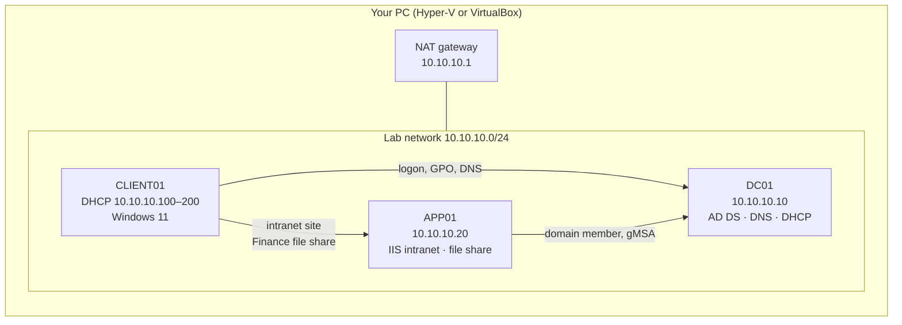

# Build an On-Premises Windows Server Lab

A hands-on tutorial for building a small company network the way a Windows administrator would: a **domain controller** running Active Directory, DNS, and DHCP, an **application server** hosting an intranet site and a department file share, and a **Windows client** that joins the domain and uses both.

You'll build it **twice**:

| Track | Guide | What you learn |
|---|---|---|
| 🖱️ **Click-ops** | [01-clickops-guide.md](./01-clickops-guide.md) | Where everything lives in Server Manager, ADUC, DNS, DHCP, Group Policy Management, and IIS Manager |
| ⌨️ **PowerShell** | [02-powershell-guide.md](./02-powershell-guide.md) and [`scripts/`](./scripts/) | How to build the same environment repeatably with scripts, the way it's done at scale |

Do the click-ops track first so you know what each setting means, then rebuild with PowerShell. Both tracks build **exactly the same lab**, with the same names, IP addresses, and settings, so you can compare them side by side.

> **Time:** about 4–6 hours for click-ops (most of it installs and reboots), and about 1–2 hours for PowerShell.
> **Cost:** free. Everything uses Microsoft's 180-day evaluation editions.

---

## What you'll build



## The plan

Every guide and script uses these values. Keeping them consistent is what makes troubleshooting possible.

### Machines

| Name | Role | OS | vCPU | RAM | Disk | IP address |
|---|---|---|---|---|---|---|
| **DC01** | Domain controller, DNS, DHCP | Windows Server 2022 (Desktop Experience) | 2 | 4 GB | 60 GB | 10.10.10.10 (static) |
| **APP01** | Application and file server | Windows Server 2022 (Desktop Experience) | 2 | 4 GB | 60 GB | 10.10.10.20 (static) |
| **CLIENT01** | Employee workstation | Windows 11 Enterprise | 2 | 4 GB | 64 GB | From DHCP |

Your PC needs about **12 GB of free RAM** to run all three at once. With less, run DC01 plus one other machine at a time.

### Network

| Setting | Value |
|---|---|
| Subnet | 10.10.10.0/24 |
| Gateway (NAT on your PC) | 10.10.10.1 |
| DNS for every lab machine | 10.10.10.10 (DC01) |
| DNS forwarders (internet lookups) | 1.1.1.1, 8.8.8.8 |
| DHCP scope | 10.10.10.100 – 10.10.10.200 |

### Domain

| Setting | Value |
|---|---|
| Domain name | `lab.local` |
| NetBIOS name | `LAB` |
| Forest/domain functional level | Windows Server 2016 (the highest for Server 2022) |

> 💡 Real companies should use a subdomain of a domain they own (like `ad.company.com`), not `.local`. `.local` is fine for an isolated lab.

### Active Directory design

```
lab.local
└── Corp                         ← all company objects live here, not in the default containers
    ├── Admins                   ← separate admin accounts (adm-*)
    ├── Users
    │   ├── Finance
    │   ├── HR
    │   └── IT
    ├── Computers                ← new workstations land here automatically
    ├── Servers
    ├── Groups
    └── Service Accounts
```

**Groups follow the AGDLP model:** user **A**ccounts go into **G**lobal groups by role (`GG-Finance-Staff`), global groups go into **D**omain **L**ocal groups by resource (`DL-FinanceShare-Modify`), and **P**ermissions are granted only to domain local groups. When someone changes jobs, you change one group membership, not dozens of folder permissions.

| Group | Type | Members | Used for |
|---|---|---|---|
| GG-Finance-Staff | Global | Finance users | Role |
| GG-HR-Staff | Global | HR users | Role |
| GG-IT-Staff | Global | IT users | Role |
| DL-FinanceShare-Modify | Domain local | GG-Finance-Staff | Modify on `\\APP01\Finance` |
| DL-FinanceShare-Read | Domain local | GG-HR-Staff | Read on `\\APP01\Finance` |
| GG-Intranet-Servers | Global | APP01 | Allowed to use the intranet service account (gMSA) |

### Accounts

| Account | Purpose |
|---|---|
| `LAB\Administrator` | Built-in. Used only to build the domain, then locked away. |
| `LAB\adm-nwang` | Your **admin** account (Domain Admins). Used only for admin work. |
| `LAB\nwang` | Your **everyday** account (IT staff). Used to sign in to CLIENT01. |
| `LAB\gmsa-intranet$` | **Group Managed Service Account** that runs the intranet site. AD rotates its password automatically. |

Separating everyday and admin accounts is basic **tiering**: if your normal account gets phished, the attacker doesn't get Domain Admin.

---

## Parts

Both guides follow the same parts:

| Part | What you do |
|---|---|
| 1 | Download the ISOs and create the virtual network and VMs |
| 2 | Install Windows Server and prepare DC01 (name, static IP, time zone) |
| 3 | Install Active Directory and promote DC01 to a domain controller |
| 4 | Configure DNS (reverse zone, forwarders) and DHCP |
| 5 | Build the OU structure, groups, users, and admin accounts |
| 6 | Set password policy and create Group Policy Objects |
| 7 | Prepare APP01 and join it to the domain |
| 8 | Turn APP01 into an application server: IIS intranet with a gMSA and HTTPS, plus a department file share |
| 9 | Join CLIENT01 and test everything as an employee |
| 10 | Verify health, back up, and troubleshoot |

## After this lab

- Harden the servers with the [Windows hardening lab](../../security/windows-hardening-lab/)
- Manage accounts with the [Active Directory toolkit](../active-directory/)
- Scan the environment with the [Nessus scan lab](../../security/nessus-scan-lab/)
